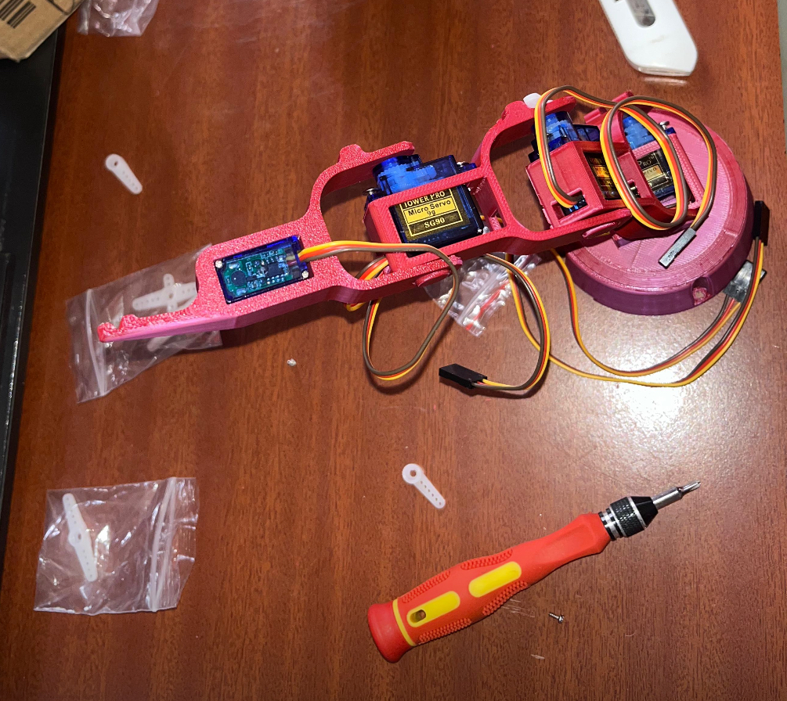
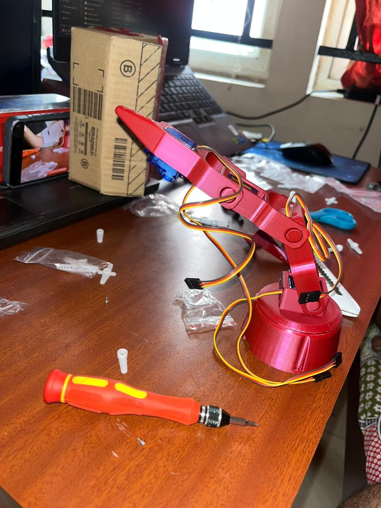

$${\color{#a80707}\huge\mathtt{Robotic Arm}}$$

3D printed robotic arm for gesture-based control using wearable gloves.

---

This project is a gesture-controlled robotic arm operated using gloves. The left glove uses **analog flex sensors** to detect finger bending for controlling the arm joints and gripper, while the right glove uses an **MPU-6050 IMU** to capture hand orientation through acceleration and gyroscope data. An **Arduino Nano** processes the sensor inputs and transmits them serially to an **Arduino Uno**, which maps the gestures to servo positions and drives the robotic arm in real time.

Uploading robotic-arm - HD 720p.mov…

<table align="center" width="100%">
  <tr>
    <td align="center">
      <video src="" controls width="100%"></video>
    </td>
  </tr>
</table>

## Prototype

  

___

## Video Showcase

### Glove Control Demo

<table align="center" width="100%">
  <tr>
    <td align="center">
      <video src="https://github.com/user-attachments/assets/6381572a-e460-491b-a36d-2951fec0c703" controls width="100%"></video>
    </td>
  </tr>
</table>

### Flex Sensor Setup

Testing bend response thresholds and LED feedback indicators:

<table align="center">
  <tr>
    <th width="50%" align="center">Red Flex Sensor</th>
    <th width="50%" align="center">Green Flex Sensor</th>
  </tr>
  <tr>
    <td align="center">
      <video src="https://github.com/user-attachments/assets/965fedab-8c5f-4fa9-917d-9d426c47fb6b" controls width="100%"></video>
    </td>
    <td align="center">
      <video src="https://github.com/user-attachments/assets/fdf8c51c-948a-4820-b297-884767910af9" controls width="100%"></video>
    </td>
  </tr>
</table>

### Servo Wiring and Test

Verifying 4-DOF servo movement, limits, and wiring before full integration:

<table align="center">
  <tr>
    <td align="center">
      <video src="https://github.com/user-attachments/assets/8cf83bed-7cbf-407b-ab3c-12a2335630e2" controls width="100%"></video>
    </td>
  </tr>
</table>

## Assembly

  
  

---

## Acknowledgements

- [Inspiration](https://youtu.be/F0ZvF-FbCr0?si=jibcifKu784Cr1pa)
- [Robotic Arm used](https://youtu.be/xILy-UI7aAQ)
